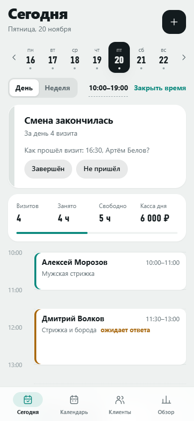
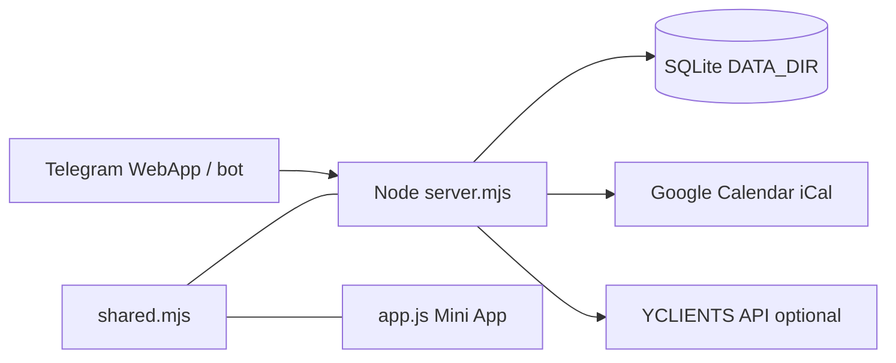

# Смена

Telegram Mini App и бот для одного мастера: день, клиенты, свободные окна и read-only синхронизация с YCLIENTS.



Бот: https://t.me/SmenaBarber_63c342_bot

## Возможности

- День / неделя / месяц: визиты, перерывы, статусы «Пришёл / Завершён / Не пришёл», повтор через 4 недели
- Клиенты: поиск, группы, карточка с историей; звонок, WhatsApp, Telegram
- «Поделиться окнами»: текст со свободным временем под услугу на 1–7 дней (бот клиентам сам не пишет)
- Обзор за 7 / 30 / 90 дней: выручка, загрузка, неявки, «пора позвать снова»
- YCLIENTS только на чтение (Google Calendar iCal или официальный API) — без хранения пароля YCLIENTS
- Напоминания в Telegram, CSV/JSON экспорт, ежедневные снимки БД и восстановление

## Архитектура



Доступ: владелец и один второй пользователь (администратор или помощник) по одноразовому приглашению.

## Стек

Node.js 24 · SQLite · Telegram Bot API / WebApp · zero npm dependencies

## Запуск

```bash
cp .env.example .env
# BOT_TOKEN, OWNER_TELEGRAM_ID, PUBLIC_URL, DATA_DIR
npm test
npm start
# или: make test && make run
```

Открывайте приложение по HTTPS через этот сервер (не `file://`). `/demo` — вымышленные данные в браузере, отдельно от личного плана.

VPS: `sh deploy/deploy.sh root@<ip> <домен>` (Docker + Caddy). Без Docker — `deploy/smena.service`. Порт в Docker — `127.0.0.1:8732`. Docker/VPS в этой среде не проверялись.

## Конфигурация

| Переменная | Назначение |
| --- | --- |
| `BOT_TOKEN` | Токен бота |
| `BOT_USERNAME` | Username без `@` (иначе из `getMe`) |
| `OWNER_TELEGRAM_ID` | Числовой Telegram id владельца |
| `PUBLIC_URL` | Публичный HTTPS origin |
| `PORT` | Порт HTTP |
| `DATA_DIR` | Каталог SQLite и снимков |
| `TRUST_PROXY` | `1` за reverse proxy |
| `YCLIENTS_*` | Опциональный официальный API |

Часовой пояс новых установок по умолчанию — **Europe/Moscow** (меняется в настройках). Полный список — `.env.example`.

## Синхронизация с YCLIENTS

Два способа, оба без хранения пароля YCLIENTS:

1. **Google Calendar iCal.** YCLIENTS выгружает записи сотрудника в Google Календарь; секретный адрес iCal вставляется в Настройки → YCLIENTS. Ссылка только в SQLite (`meta`), не в экспорте и не в ответах API.
2. **Официальный API** (`YCLIENTS_PARTNER_TOKEN`, `YCLIENTS_USER_TOKEN`, `YCLIENTS_COMPANY_ID`, `YCLIENTS_STAFF_ID`) — если есть права администратора филиала.

Сервер тянет записи каждые 5 минут и по кнопке «Обновить». Записи YCLIENTS read-only (API 403 на правку). Свободные окна и `/free` их учитывают. На живом филиале / API ещё не проверялось; iCal — на настоящем Google Calendar.

## Безопасность

- HMAC Telegram `initData`, срок подписи, allow-list Telegram id
- Сессия 8 часов; Bearer в памяти страницы + HttpOnly cookie; не в `localStorage`
- Календарный feed: фиксация адреса, allow-list IP, общий таймаут (SSRF)
- Optimistic concurrency: `revision` на форме
- Снимки БД и безопасное восстановление

## Бот

| Команда | Что делает |
| --- | --- |
| `/today`, `/tomorrow`, `/day 14.11` | План дня |
| `/week` | Неделя |
| `/free [день]` | Свободные окна |
| `/next` | Ближайший клиент + статусы |
| `/add завтра 15:30 Иван` | Запись из чата |
| `/find …` | Поиск клиента |
| `/stats` | Итоги недели |
| `/invite`, `/help` | Приглашение (владелец) и справка |

Пока второй пользователь не приглашён, напоминания получает владелец; после выдачи — второй пользователь.

## Проверки

Серверные тесты и браузерные сценарии — [RELEASE_CHECKS.md](RELEASE_CHECKS.md). Аналоги — [RESEARCH.md](RESEARCH.md).

Проверено: `npm test`, локальный `/demo`, iCal на Google Calendar, ширины 320–1060 px.  
Не проверено: полный iframe Telegram Web на 0.5, живой филиал YCLIENTS / API, деплой на VPS в этой среде.

## Структура

| Путь | Роль |
| --- | --- |
| `index.html` `app.js` `app.css` | Mini App |
| `shared.mjs` | День, окна, сводки (общее для UI и бота) |
| `server.mjs` | HTTP/API, auth, статика |
| `lib/` | core, store, bot, sync, views, reminders |
| `tests/` | `node:test` без реального Telegram |
| `docs/screenshots/` | Снимки UI |

## Лицензия

[MIT](LICENSE). Автор: Богдан Щербинин ([blessed-bless](https://github.com/blessed-bless)).
